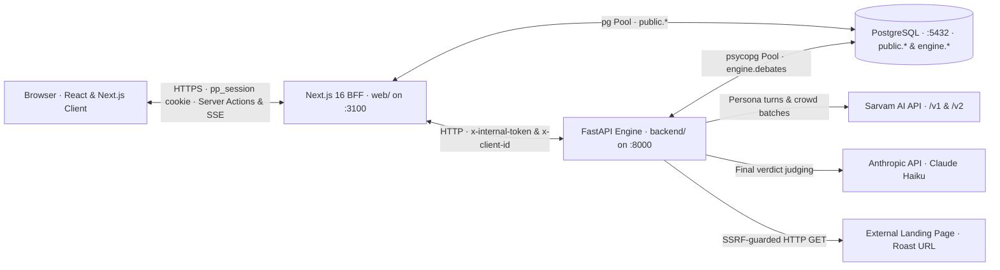
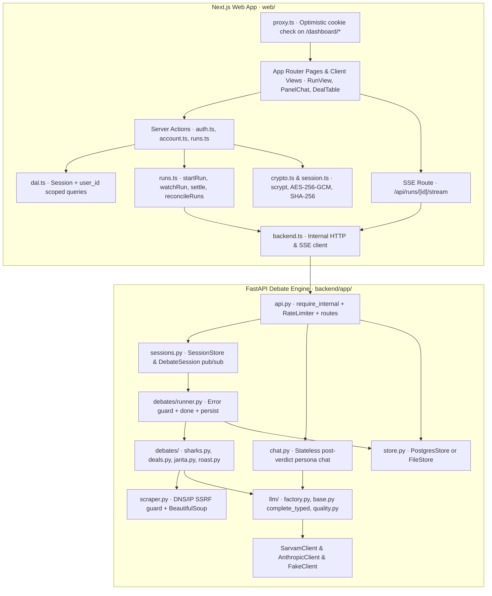
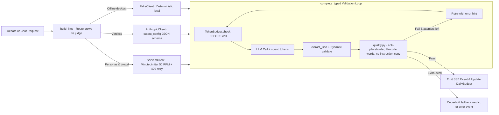
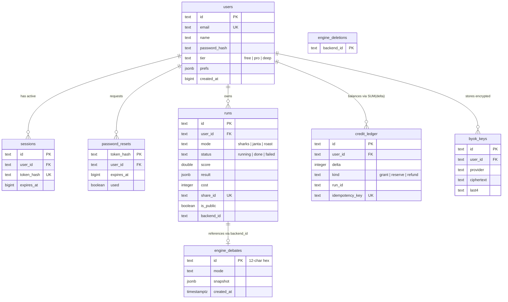

# 01 · System Architecture

> **Written before the rename.** This document says "Pitch Panchayat"; the product is now **Sabhora by Neevora Labs**. The architecture, data flows and APIs are unchanged. Internal names (folder, database, log tags) still use the old name on purpose. The PDF in `pdf/` is from before the rename.

**Scope:** This document covers the static structure of Pitch Panchayat—services, modules, trust boundaries, persistence, and infrastructure constraints. For step-by-step runtime sequences, see [02 · User & Data Flow](./02-user-data-flow.md). For endpoint contracts, see [03 · API Reference](./03-api-reference.md).

---

## 1. High-Level Topology & Trust Boundaries

Pitch Panchayat uses a **two-service Backend-for-Frontend (BFF) architecture** backed by a single **PostgreSQL** database with two schemas (`public` and `engine`). The browser never talks directly to FastAPI or PostgreSQL.

### Design Split

| Layer | Directory | Responsibility |
|---|---|---|
| **Web / BFF** | `web/` | Marketing site, user accounts, `scrypt` auth & sessions, credit ledger, tier entitlements, encrypted BYOK storage, SSE relay (`sanitizeEvent`), and Postgres persistence of finished runs (`public.runs`). |
| **Debate Engine** | `backend/` | Stateless-to-the-user AI orchestration (Sharks, Janta, Roast, Deal Table, Follow-up Chat), persona loading/generation, token budgets, provider rate limiting, SSRF-checked scraping, and debate snapshot storage (`engine.debates`). |
| **Database** | `db/migrations/` | Single PostgreSQL 17 instance holding web tables in `public.*` and engine snapshots in `engine.debates`. |
| **Prototype UI** | `frontend/index.html` | Standalone single-file HTML prototype served by FastAPI at `/` when `INTERNAL_API_TOKEN` is unset (disabled in production). |

---

## 2. Internal Component Architecture

---

## 3. Trust Boundaries & Security Controls

1. **Browser ↔ Next.js (`web/`):**
   - Authentication uses opaque 256-bit random tokens stored in an `HttpOnly`, `SameSite=Lax` cookie (`pp_session`). Only the SHA-256 hash is persisted in `public.sessions` (`web/lib/session.ts`).
   - Passwords are hashed with `scrypt` (`N=32768, r=8, p=1`, NFKC-normalized) and verified via `timingSafeEqual` with a dummy-hash check on unknown emails (`web/lib/crypto.ts`).
   - `proxy.ts` performs an optimistic cookie check on `/dashboard/*`; authoritative session + ownership validation happens in `web/lib/dal.ts` and every Server Action / API route.
   - `next.config.ts` sets `X-Frame-Options: DENY`, `X-Content-Type-Options: nosniff`, `Referrer-Policy`, `Permissions-Policy`, and production `HSTS`, and disables `X-Powered-By`.
2. **Next.js ↔ FastAPI (`backend/`):**
   - The browser **never** calls FastAPI directly in the full product.
   - All `/api/debates*` routes enforce `x-internal-token` via `hmac.compare_digest` (`backend/app/api.py:require_internal`). Startup with `ENV=prod` fails unless `INTERNAL_API_TOKEN` is at least 32 characters (`backend/app/settings.py`).
   - Next.js forwards `x-client-id: <userId>` so FastAPI rate-limits per end user rather than per web-server IP.
   - `web/lib/events.ts:sanitizeEvent()` strips `tokens`, `crowd_model`, `judge_model`, and raw provider error details before events reach the browser or `public.runs.result`.
3. **FastAPI ↔ External Websites (Roast Mode):**
   - `backend/app/scraper.py` restricts schemes to `http`/`https`, resolves DNS via `getaddrinfo()` before each hop (up to 5 redirects), blocks private/loopback/link-local/reserved/multicast/unspecified IPs, requires `html` content-type, and caps reads at `2 MB` and `12 s`.
4. **Encrypted BYOK Keys:**
   - Stored in `public.byok_keys` encrypted with **AES-256-GCM** using a key derived from `AUTH_SECRET` (`sha256("byok:" + AUTH_SECRET)`). (The backend already accepts `x-anthropic-key` / `x-sarvam-key` headers per request, while the web app currently stores keys encrypted without forwarding them to runs yet.)

---

## 4. LLM Routing, Budgeting & Validation Pipeline

Every AI call passes through one typed gate (`complete_typed()`) with separate token reserves so questioning can never starve the deal table or final verdict.

### Key Architectural Patterns

- **Ordered Event Log + Cursor Replay:** Every `DebateSession` stores events with sequential integer IDs (`0, 1, ...`). Reconnecting SSE clients pass `Last-Event-ID` or `?after=`, and `subscribe()` replays missed events before tailing live events via `asyncio.Condition`.
- **Two-Tier LLM Routing:**
  - `LLM_PROVIDER` (default `sarvam` / `sarvam-105b-conversations`) handles high-volume persona calls (sharks, crowd batches, roasters, follow-up chat).
  - `JUDGE_PROVIDER` (default `anthropic` / `claude-haiku-5-5`) handles low-volume final synthesis verdicts where strict instruction adherence matters.
- **Reserved Budgets:** Debates allocate separate `TokenBudget` instances for questioning (`MAX_TOKENS_PER_DEBATE=60,000`), Sharks deal negotiation (`DEAL_RESERVE_TOKENS=25,000`), and the final verdict (`JUDGE_RESERVE_TOKENS=30,000`).
- **Deterministic Calculations in Code:** Janta vote tallies, segment breakdowns, Roast average scores, and Sharks implied valuations/offer constraints (`deals.py`) are always computed in Python, never trusted to LLM arithmetic.

---

## 5. Database Entity-Relationship Diagram (`db/migrations/001_init.sql`)

---

## 6. Current Scaling Boundaries (Single-Instance Design)

The codebase is explicitly designed as a **single-instance deployment** for each tier:
1. **Live Debate Memory:** Active `DebateSession` objects, `founder_inbox`, and `deal_inbox` live in the FastAPI process memory (`SessionStore`). Multi-worker uvicorn or multiple engine pods would break SSE streaming and founder replies unless backed by Redis pub/sub and sticky routing.
2. **In-Memory Limiters & Budgets:** `RateLimiter` (both Python and TypeScript) and `DailyBudget` live in process memory and reset on restart.
3. **In-Process Run Watcher:** `web/lib/runs.ts:watchRun()` uses `setTimeout` inside the Next.js Node server (with `reconcileRuns()` as a fallback on page load). Scaling `web/` horizontally requires moving `watchRun()` to a shared job queue.
