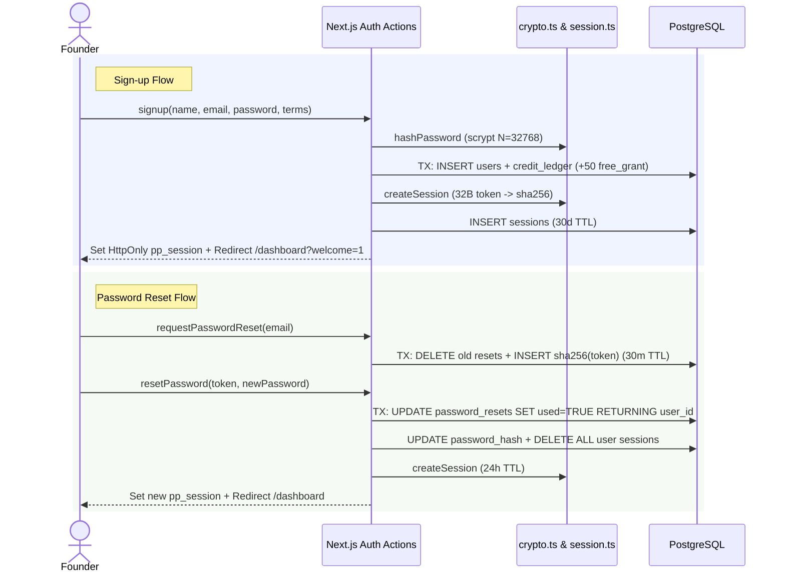
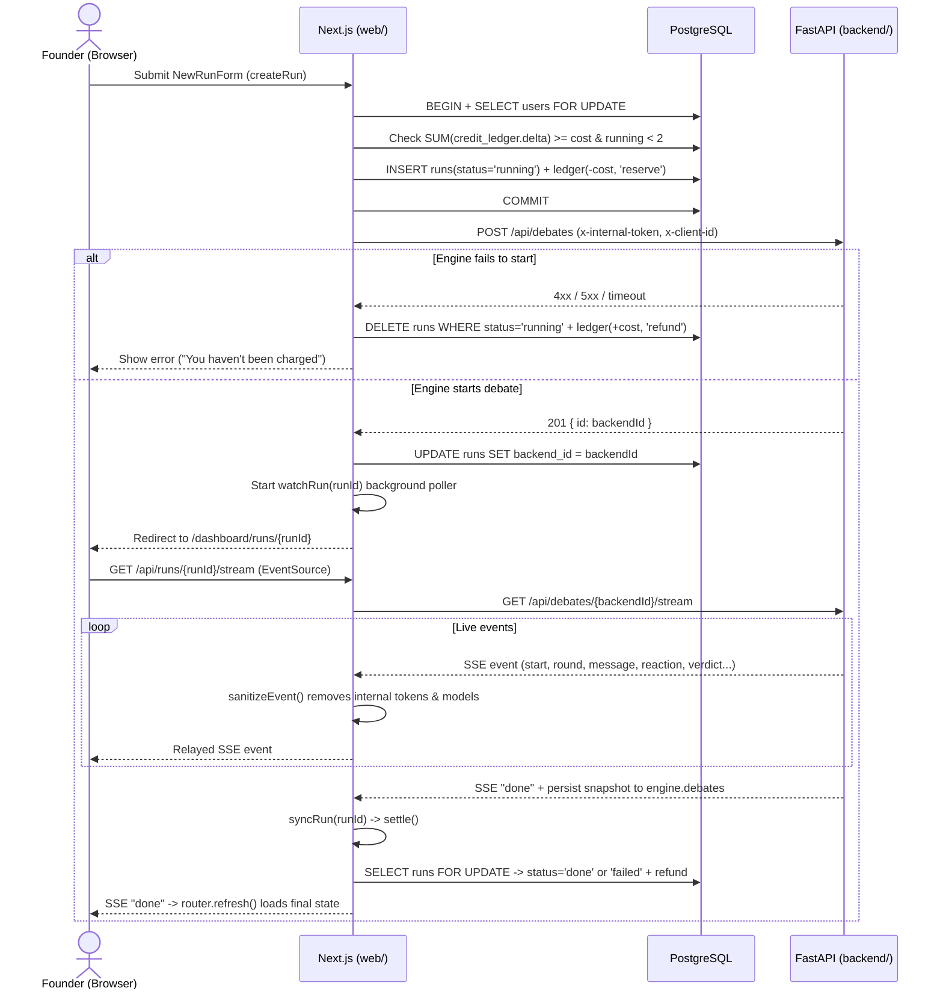
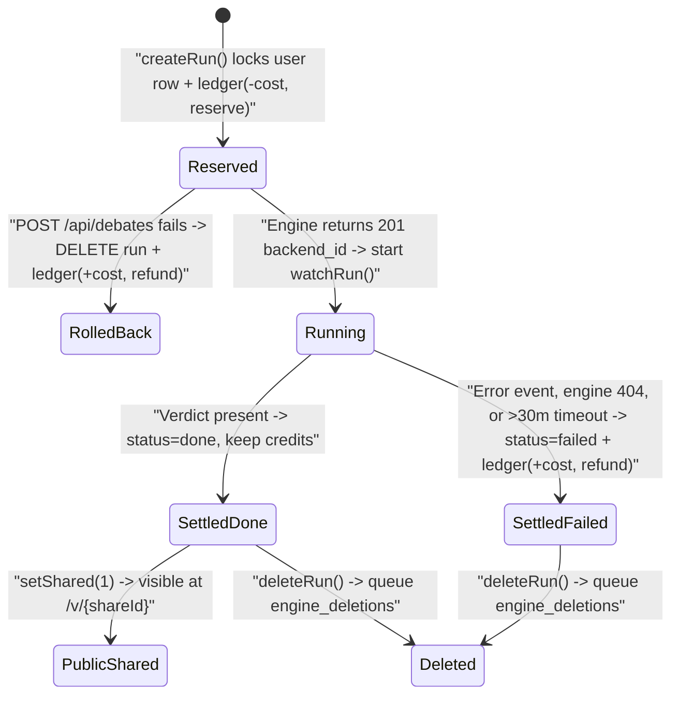
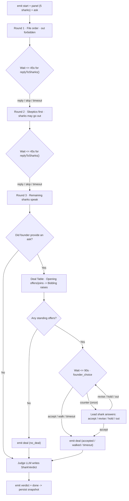
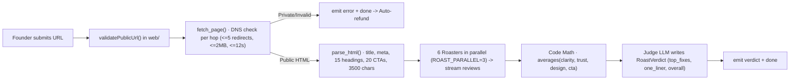
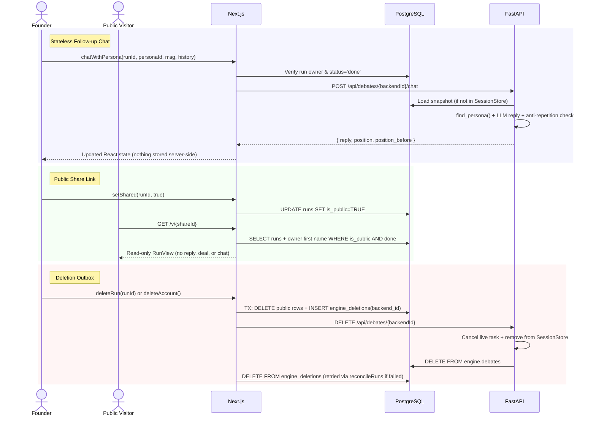

# 02 · User & Data Flow

> **Written before the rename.** This document says "Pitch Panchayat"; the product is now **Sabhora by Neevora Labs**. The architecture, data flows and APIs are unchanged. Internal names (folder, database, log tags) still use the old name on purpose. The PDF in `pdf/` is from before the rename.

**Scope:** This document traces how user actions, money (credits), and AI events move through Pitch Panchayat at runtime. For module structure, see [01 · Architecture](./01-architecture.md). For exact endpoint schemas, see [03 · API Reference](./03-api-reference.md).

---

## 1. Authentication & Account Data Flow

### Key Auth Details
- **Login Timing Protection:** `login` (`5 / 15m` per IP+email, `30 / 15m` per IP) always executes `verifyPassword()` against the user's hash—or `getDummyHash()` for unknown emails—to equalize response time.
- **Session Rotation:** Signing in deletes the prior `pp_session` row; `changePassword` revokes all *other* sessions; `resetPassword` revokes *all* sessions.

---

## 2. Run & Credit Lifecycle (Reserve → Stream → Settle / Refund)

### 2.1 End-to-End Sequence

### 2.2 Run & Credit State Machine (`web/lib/runs.ts`)

### Credit Invariants
- **No Double-Spend:** `startRun()` locks `users` (`FOR UPDATE`), checks `SUM(delta) >= cost`, enforces `MAX_RUNNING = 2`, and writes `-cost` with `idempotency_key = 'reserve:' + runId`.
- **No Double-Refund / Double-Settle:** `settle()` locks `runs` (`FOR UPDATE`). If `status !== 'running'`, it returns immediately; unique `idempotency_key` (`'refund:' + runId`) prevents duplicate ledger entries.
- **Crash / Tab-Close Recovery:** `watchRun()` polls `syncRun()` every 3s (up to 31 minutes) even if the browser closes. If `web/` restarts, `reconcileRuns(userId)` catches up whenever the user loads the dashboard, runs list, run page, or ledger.

---

## 3. Room-Specific Execution Data Flows

### 3.1 Sharks Mode (`backend/app/debates/sharks.py` + `deals.py`)

1. **Questioning (`3` rounds):** Round 1 uses YAML order (`meera`, `arjun`, `ananya`, `vikram`, `farah`). Rounds 2–3 sort remaining sharks by skepticism (`pass` → `maybe` → `invest`).
2. **Deal Table (`deals.py`):** `check_terms()` enforces `0.5x–1.5x` ask amount, `<=75%` equity, `<=15%` royalty, and `<=24%` debt interest. In bidding, `is_better()` guarantees competing raises only improve terms for the founder. Accepted counters always lock in the founder's exact numbers.

### 3.2 Janta Mode (`backend/app/debates/janta.py`)

```mermaid
flowchart LR
    Gen["generate_crowd(N, seed=42)"] --> R1["Round 1 · Batches of 3 (6 parallel) -> CrowdReaction"]
    R1 -->|"Batch LLMError"| Fallback1["Fallback: 1 call per person"]
    R1 --> Digest["digest() · R1 tally + sample quotes"]
    Fallback1 --> Digest
    Digest --> R2["Round 2 · Swing voters only (all neutral + 1/3 decided) · 1 per call"]
    R2 --> Math["Code Math · tally() & segment_breakdown()"]
    Math --> Judge["Judge LLM writes JantaSummary"]
    Judge --> Done["emit verdict + done"]
```

- **Why Two-Stage:** Round 1 captures independent reactions in batches of 3 (`JANTA_BATCH_SIZE=3`) to cut API calls by ≈3x. Round 2 re-asks swing voters individually so they don't copy Round 1 quotes verbatim (`check_reaction` verifies uniqueness).
- **Zero-Token Analytics:** Vote percentages, willingness-to-pay (`would_pay_pct`), and breakdowns (`City tier`, `Age`, `Attitude`, `Phone use`, `Model`) are computed deterministically in Python.

### 3.3 Roast Mode (`backend/app/debates/roast.py` + `scraper.py`)

---

## 4. Post-Verdict Chat, Sharing & Deletion Data Flows

