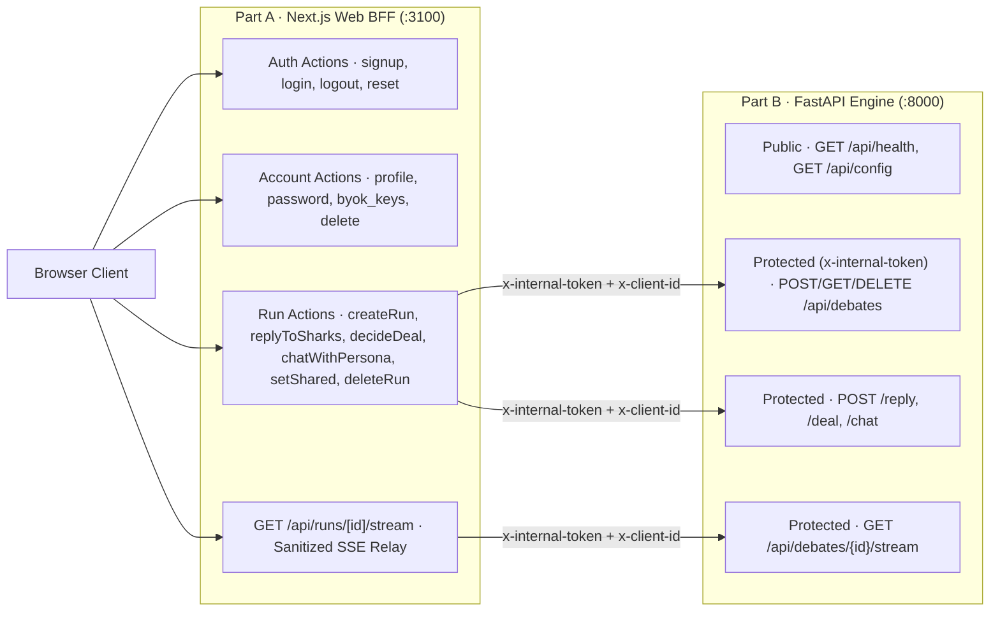
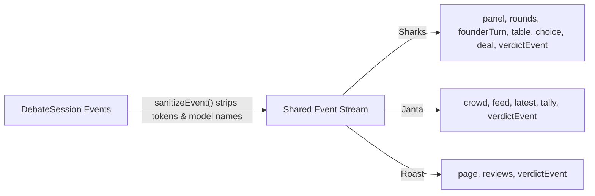

# 03 · API Reference

> **Written before the rename.** This document says "Pitch Panchayat"; the product is now **Sabhora by Neevora Labs**. The architecture, data flows and APIs are unchanged. Internal names (folder, database, log tags) still use the old name on purpose. The PDF in `pdf/` is from before the rename.


**Scope:** Complete interface specification for both surfaces:
- **Part A — Web BFF Surface (`web/`):** Browser-facing HTTP endpoints and Next.js Server Actions.
- **Part B — FastAPI Engine API (`backend/`):** Internal REST & SSE endpoints called by `web/`.

For sequence diagrams showing how these calls fit together, see [02 · User & Data Flow](./02-user-data-flow.md).

---

## API Surface Map



---

## Part A · Web BFF Surface (`web/`, port `3100`)

### A.1 HTTP Route: SSE Run Stream

#### `GET /api/runs/{id}/stream`
Streams live debate events for an active run, or replays sanitized saved events for a finished run.

- **Auth:** Requires `pp_session` cookie (`401 Sign in required` if missing/expired).
- **Ownership:** Queries `runs WHERE id = $1 AND user_id = $2` (`404 Not found` if not owned).
- **Headers / Query:**
  - `Last-Event-ID` header or `?after=<int>` query param: resumes strictly after event `id`.
- **Response (`200 text/event-stream`):**
  - Frames formatted as `id: <int>\ndata: <JSON RunEvent>\n\n` (plus `: ping\n\n` heartbeats).
  - Internal fields (`tokens`, `crowd_model`, `judge_model`, raw provider error strings) are stripped via `sanitizeEvent()`.
  - When `type === "done"` arrives, the route settles the run in PostgreSQL before flushing the `done` frame to the browser.
- **Status Codes:** `200` (stream/replay), `401` (unauthenticated), `404` (not found/not owner), `503` (engine starting/unreachable/unavailable).

---

### A.2 Next.js Server Actions (Browser → Next.js Server)

All Server Actions validate inputs server-side and enforce session auth (except `auth.ts` login/signup/reset).

#### Authentication Actions (`web/app/actions/auth.ts`)

| Action | FormData / Args | Rate Limit | Behavior & Validation |
|---|---|---|---|
| `signup` | `name`, `email`, `password`, `terms="on"`, `next?` | `10 / 1h` per IP | Validates email (`<=254`), name (`2..60`), password (`>=10` chars, letter+number, not common). Creates user + `+50` `grant` in `credit_ledger`, sets `pp_session`, redirects. |
| `login` | `email`, `password`, `remember?`, `next?` | `5 / 15m` per IP+email; `30 / 15m` per IP | `scrypt` verify (timing-equalized with dummy hash on miss), rotates session, redirects to sanitized `/dashboard*` path. |
| `logout` | — | — | Deletes current `sessions` row, clears `pp_session`, redirects to `/login`. |
| `requestPasswordReset` | `email` | `5 / 15m` per IP | Creates 30-minute single-use `password_resets` row. Always returns generic confirmation message to prevent email enumeration. |
| `resetPassword` | `token`, `password` | — | Atomically marks reset token `used = TRUE`, updates `password_hash`, deletes **all** user sessions, creates new 24h session, redirects to `/dashboard`. |

#### Account Actions (`web/app/actions/account.ts`, require `getCurrentUser()`)

| Action | FormData | Behavior |
|---|---|---|
| `updateProfile` | `name`, `role`, `company`, `city`, `bio` | Validates `name` (`2..60`) and `role` enum (`Founder`, `Co-founder`, `Product manager`, `Student`, `Investor`, `Other`, `""`); truncates optional fields. |
| `changePassword` | `current`, `password` | Rate-limited `5 / 15m` per user. Verifies current password, updates hash, revokes all *other* sessions. |
| `signOutOtherDevices` | — | Deletes all `sessions` for `user.id` except current `token_hash`. |
| `updatePrefs` | `emailOnFinish`, `productUpdates` | Saves boolean notification prefs to `users.prefs` JSONB. |
| `saveApiKey` | `provider` (`anthropic` \| `sarvam`), `key` | Requires `pro` or `deep` tier. Validates key format (`20..300` chars, `sk-ant-` for Anthropic), encrypts with AES-256-GCM, stores `ciphertext` + `last4`. |
| `deleteApiKey` | `id` | Deletes from `byok_keys WHERE id = $1 AND user_id = $2`. |
| `deleteAccount` | `confirm` (email), `password` | Verifies email & password, locks user row, queues `runs.backend_id` into `engine_deletions`, deletes user (cascade), flushes engine deletions, clears cookie. |

#### Run & Debate Actions (`web/app/actions/runs.ts`, require `getCurrentUser()`)

| Action | Arguments | Rate Limit / Guard | Behavior |
|---|---|---|---|
| `createRun` | `mode`, `idea`, `customer`, `price`, `tone`, `url`, `panelSize`, `askAmount`, `askEquity` | `20 / 1h` per user; `MAX_RUNNING = 2`; tier `jantaMax` check; `balance >= cost` | Reserves credits, creates `runs` row, calls FastAPI `POST /api/debates` (refunds immediately on error), redirects to `/dashboard/runs/{id}`. |
| `replyToSharks` | `(runId, text: string \| null)` | Owner + `status='running'` + `mode='sharks'` | Sends founder answer (`<=500` chars) or `{ skip: true }` to `POST /api/debates/{backendId}/reply`. |
| `decideDeal` | `(runId, move: DealMove)` | Owner + `status='running'` + `mode='sharks'` | Sends `accept`, `counter` (`investment_lakh`, `equity_pct`, `royalty_pct`), or `walk` to `POST /api/debates/{backendId}/deal`. |
| `chatWithPersona` | `(runId, personaId, message, history)` | Owner + `status='done'`; `60 / 1h` per user | Sends message (`<=500` chars) + last 20 turns (`<=1000` chars each) to `POST /api/debates/{backendId}/chat`. |
| `setShared` | `id`, `public` (`"1"` \| `"0"`) | Owner + `status='done'` | Toggles `runs.is_public` for `/v/{shareId}` replay access. |
| `deleteRun` | `id` | Owner + `status != 'running'` | Deletes `runs` row, queues & flushes `DELETE /api/debates/{backendId}`, redirects to `/dashboard/runs`. |

---

## Part B · FastAPI Engine API (`backend/`, port `8000`)

### B.1 Authentication & Common Headers

- **Internal Guard (`require_internal`):** When `INTERNAL_API_TOKEN` is set (required when `ENV=prod`), all `/api/debates*` endpoints require:
  - `x-internal-token: <INTERNAL_API_TOKEN>` (validated via `hmac.compare_digest`; returns `401` on mismatch/missing).
- **Rate-Limit Attribution:**
  - `x-client-id: <userId>` — honored **only** when `INTERNAL_API_TOKEN` is configured; otherwise ignored and rate limiting falls back to `request.client.host`.
- **BYOK Headers (optional, single-request only, never stored/logged):**
  - `x-anthropic-key: sk-ant-...`
  - `x-sarvam-key: ...`

---

### B.2 Public Utility Endpoints

#### `GET /api/health`
Unauthenticated health & capacity check.
```json
{
  "status": "ok",
  "env": "dev",
  "active_debates": 0,
  "daily_tokens_used": 0
}
```

#### `GET /api/config`
Unauthenticated UI capability metadata.
```json
{
  "crowd_provider": "sarvam",
  "judge_provider": "anthropic",
  "shark_rounds": 3,
  "founder_wait_s": 45.0,
  "janta_size": 50,
  "janta_max_size": 100,
  "janta_rounds": 2
}
```

*(Note: `GET /` and `GET /d/{debate_id}` serve the standalone `frontend/index.html` prototype.)*

---

### B.3 Debate Lifecycle Endpoints (Protected by `INTERNAL`)

#### `POST /api/debates`
Starts a debate asynchronously and returns immediately.

- **Rate Limits & Guards:**
  - `RATE_LIMIT_PER_HOUR` (default `30/hr` per client key) → `429`
  - Daily server token cap (`DAILY_TOKEN_LIMIT=600000`, bypassed when BYOK headers present) → `503`
  - Active concurrency cap (`MAX_ACTIVE_DEBATES=20`) → `503`
  - Janta size cap (`panel_size <= JANTA_MAX_SIZE`) → `400`
  - Missing provider key → `400`
- **Request Body (`CreateDebate`):**
  - **Sharks:**
    ```json
    {
      "mode": "sharks",
      "tone": "roast",
      "pitch": "KiranaOne: WhatsApp-first ordering app for kirana shops...",
      "ask_amount_lakh": 50,
      "ask_equity_pct": 5
    }
    ```
    *Constraints:* `pitch` `20..2000` chars; `tone` `"roast" | "serious"`; `ask_amount_lakh` (`1..100000`) and `ask_equity_pct` (`0.1..100`) must either both be provided or both omitted.
  - **Janta:**
    ```json
    {
      "mode": "janta",
      "pitch": "KiranaOne: WhatsApp-first ordering app for kirana shops...",
      "panel_size": 50
    }
    ```
    *Constraints:* `pitch` `20..2000` chars; `panel_size` `5..500` (capped by `janta_max_size`, default `100`).
  - **Roast:**
    ```json
    {
      "mode": "roast",
      "url": "https://example.com"
    }
    ```
    *Constraints:* valid `HttpUrl` (`http` or `https`).
- **Response (`201 Created`):**
  ```json
  { "id": "a1b2c3d4e5f6", "mode": "sharks" }
  ```

#### `GET /api/debates/{debate_id}`
Returns the full snapshot (from live memory if active, else `engine.debates` / file store).

- **Response (`200 OK`):**
  ```json
  {
    "id": "a1b2c3d4e5f6",
    "mode": "janta",
    "request": { "...": "..." },
    "events": [ { "id": 0, "type": "start", "...": "..." } ],
    "finished": true
  }
  ```
- **Errors:** `401` (unauthorized), `404` (`Debate not found`; non-hex IDs are rejected safely).

#### `DELETE /api/debates/{debate_id}`
Cancels a running debate (if active) and deletes its saved snapshot from memory and `engine.debates` / disk.
- **Response:** `204 No Content`.

#### `GET /api/debates/{debate_id}/stream`
Server-Sent Events (`text/event-stream`) for a live or recently finished session in memory.

- **Query / Header:** `?after=-1` or `Last-Event-ID: <int>`.
- **Heartbeats:** Emits `: ping\n\n` every `15s` when idle.
- **Errors:** `404` if not in `SessionStore` (finished runs after restart/TTL must use `GET /api/debates/{id}`).

##### How Events Map to UI State (`deriveRun`)



##### SSE Event Catalog (`RunEvent`)

| `type` | Modes | Key Fields |
|---|---|---|
| `start` | All | `mode`, `rounds?`, `panel?` (`[{id,name,title}]`), `ask?`, `size?`, `crowd?`, `url?` |
| `round` | Sharks, Janta | `round`, `asked?` (Janta round 2 swing count) |
| `typing` | Sharks | `speaker`, `name` |
| `message` | Sharks | `round`, `speaker`, `name`, `text`, `stance` (`invest\|maybe\|pass`), `confidence` (`1..10`), `out` |
| `founder_turn` | Sharks | `wait_s`, `expires_at` (epoch seconds) |
| `founder` | Sharks | `round`, `text` |
| `founder_skipped` | Sharks | `round` |
| `offers_open` | Sharks | — |
| `offer` | Sharks | `speaker`, `name`, `text`, `action` (`offer\|join\|out\|improve\|hold\|withdraw`), `offer` |
| `founder_choice` | Sharks | `offers`, `can_counter`, `wait_s`, `expires_at` |
| `founder_deal` | Sharks | `action` (`accept\|counter\|walk`), `offer` |
| `counter_reply` | Sharks | `speaker`, `name`, `text`, `action` (`accept\|revise\|hold\|out`), `offer` |
| `deal` | Sharks | `outcome` (`deal\|no_deal`), `reason` (`accepted\|counter_accepted\|walked\|timeout\|withdrawn\|all_out\|no_offers`), `offer` |
| `reaction` | Janta | `round`, `persona_id`, `vote` (`agree\|neutral\|disagree`), `comment`, `would_pay`, `changed` |
| `tally` | Janta | `round`, `agree`, `neutral`, `disagree`, `total`, `would_pay`, `would_pay_pct` |
| `fetching` | Roast | `url` |
| `page` | Roast | `url`, `title`, `description`, `headings` |
| `review` | Roast | `roaster`, `name`, `title`, `review` (`{roast, clarity, trust, design, cta, fix}`) |
| `notice` | All | `text` |
| `judging` | All | — |
| `verdict` | All | Sharks: `verdict`; Janta: `summary`, `tally`, `segments`; Roast: `verdict`, `averages` |
| `error` | All | `message` |
| `done` | All | `tokens`, `crowd_model`, `judge_model` *(stripped by Next.js `sanitizeEvent`)* |

---

### B.4 Interactive & Follow-Up Endpoints

#### `POST /api/debates/{debate_id}/reply`
Submits the founder's mid-debate answer in Sharks mode.
- **Body (`FounderReply`):** `{ "text": "32 of 40 shops reorder weekly." }` or `{ "skip": true }` (`text` max `500` chars).
- **Response:** `200 { "ok": true }`
- **Errors:** `404` (no live Sharks debate), `409` (not currently awaiting founder or already answered), `422` (empty text with `skip=false`).

#### `POST /api/debates/{debate_id}/deal`
Submits the founder's move at the Sharks deal table.
- **Body (`FounderDeal`):**
  ```json
  {
    "action": "counter",
    "offer_id": "meera",
    "investment_lakh": 50,
    "equity_pct": 7.5,
    "royalty_pct": 0
  }
  ```
  *Constraints:* `action` in `accept | counter | walk`; `offer_id` required unless `walk`; `investment_lakh` (`1..100000`) and `equity_pct` (`0.1..100`) required for `counter`; `royalty_pct` (`0..15`).
- **Response:** `200 { "ok": true }`
- **Errors:** `404` (no live Sharks debate), `409` (no open offers, invalid `offer_id`, counter already used, or already answered).

#### `POST /api/debates/{debate_id}/chat`
Stateless post-verdict 1-to-1 chat with any persona from the debate.
- **Rate Limit:** `CHAT_RATE_PER_HOUR` (`120/hr` per client key) → `429`.
- **Precondition:** Debate must exist (live or saved) and already have a `verdict` event (`409` otherwise).
- **Body (`ChatRequest`):**
  ```json
  {
    "persona_id": "j001",
    "message": "What would make you pay for this?",
    "history": [
      { "role": "founder", "text": "Hi" },
      { "role": "persona", "text": "Hello beta." }
    ]
  }
  ```
  *Constraints:* `persona_id` `1..20` chars; `message` `1..500` chars; `history` up to `40` turns (`text` `1..1000` chars, last 12 sent to LLM).
- **Response (`200 OK`):**
  ```json
  {
    "persona_id": "j001",
    "name": "Ramesh",
    "reply": "Agar distributor free trial de aur Hindi mein bill mile toh main try karunga.",
    "position": "agree",
    "position_before": "neutral"
  }
  ```
  *(For Roasters, `position` and `position_before` are `null`.)*
- **Errors:** `401`, `404` (debate or persona not found), `409` (no verdict yet), `429`, `502` (LLM/budget failure), `503` (daily cap exhausted).
