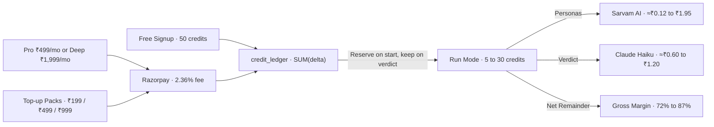

# 04 · Pricing Predictions & Unit Economics

> **Written before the rename.** This document says "Pitch Panchayat"; the product is now **Sabhora by Neevora Labs**. The architecture, data flows and APIs are unchanged. Internal names (folder, database, log tags) still use the old name on purpose. The PDF in `pdf/` is from before the rename.

**Scope:** This document combines **measured AI token usage and model costs** from this codebase with **unit-economics modeling, infrastructure cost estimates, break-even thresholds, and revenue targets** for Pitch Panchayat.

> **Important distinction:** Retail credit prices and token measurements below come directly from [`web/lib/pricing.ts`](../web/lib/pricing.ts), [`backend/scripts/model_bakeoff.py`](../backend/scripts/model_bakeoff.py), [`backend/scripts/bakeoff_results.json`](../backend/scripts/bakeoff_results.json), and saved live runs in `backend/data/debates/`. Infrastructure burn, conversion rates, and MRR scenarios are **planning projections** to guide launch targets.

---

## 1. Money & Credit Economics Flow

---

## 2. Current Retail Pricing & Plans (`web/lib/pricing.ts`)

Retail anchor: **1 credit ≈ ₹1** (free sign-up grant = **50 credits**).

### 2.1 Per-Run Credit Prices

| Room / Size | Credits | Effective Price (at ₹1/cr) | Effective Price (Top-up ₹999 pack ≈ ₹0.77/cr) |
|---|---|---|---|
| **Roast** (6 reviewers + verdict) | **5** | ₹5.00 | ₹3.84 |
| **Sharks** (5 investors, 3 rounds + deal table + verdict) | **15** | ₹15.00 | ₹11.53 |
| **Janta · 25 people** (Free/Pro/Deep) | **10** | ₹10.00 | ₹7.68 |
| **Janta · 50 people** (Pro/Deep) | **20** | ₹20.00 | ₹15.37 |
| **Janta · 100 people** (Pro/Deep) | **30** | ₹30.00 | ₹23.05 |

### 2.2 Subscription Plans & Top-up Packs

| Plan / Pack | Price (INR) | Credits Included | Implied ₹ / Credit | Key Entitlements (`pricing.ts`) |
|---|---|---|---|---|
| **Free** | ₹0 | 50 one-time | — | Sharks, Roast, Janta up to 25 (`jantaMax: 25`), no BYOK |
| **Pro** | ₹499 / mo | 600 / mo | ₹0.83 | Janta up to 150 (`jantaMax: 150`), BYOK enabled |
| **Deep** | ₹1,999 / mo | 3,000 / mo | ₹0.67 | Janta up to 500 (`jantaMax: 500`), BYOK enabled |
| **Pack p220** | ₹199 | 220 | ₹0.90 | One-off top-up, never expires |
| **Pack p600** | ₹499 | 600 | ₹0.83 | Best value (+20% bonus) |
| **Pack p1300** | ₹999 | 1,300 | ₹0.77 | +30% bonus |

> **Code alignment gap to close before launch:** `ENTITLEMENTS` sets `pro.jantaMax = 150` and `deep.jantaMax = 500`, whereas `JANTA_SIZES` is `[25, 50, 100]` and `backend/.env` sets `JANTA_MAX_SIZE=100`. Either add `150`/`500` options & raise `JANTA_MAX_SIZE` (with pricing rules for `>100`) or align copy to `100`.

---

## 3. Measured AI Token & Provider Costs

Current production split in `backend/.env`:
- **Personas (`LLM_PROVIDER`):** `sarvam` (`sarvam-105b-conversations`)
  - Catalogue price in `model_bakeoff.py`: **₹10 / 1M input tokens**, **₹25 / 1M output tokens** (blended ≈₹15–₹18 / 1M total tokens).
  - Measured in `bakeoff_results.json`: `725` tok/call (₹0.0087) for Sharks turns, `764` tok/call (₹0.0111) for 3-person Janta batches, `662` tok/call (₹0.0077) for R2 swing voters.
- **Verdict Judge (`JUDGE_PROVIDER`):** `anthropic` (`claude-haiku-5-5`, `ANTHROPIC_EFFORT=low`)
  - Estimated blended Haiku-class pricing: ≈₹85–₹100 / 1M input tokens and ≈₹425–₹500 / 1M output tokens (≈$1/1M in, $5/1M out at ₹85/USD), meaning **1 verdict call (≈3k–5k total tokens, ≈1k output)** costs roughly **₹0.60–₹1.20** per run.

### Observed Token Usage (from `README.md` & `backend/data/debates/*.json`)

| Mode | Observed Tokens (Sarvam + Claude split) | Est. Sarvam Cost | Est. Claude Judge Cost | Total Est. AI COGS / Run |
|---|---|---|---|---|
| **Roast** (6 reviews + verdict) | ≈10,000 – 16,300 | ₹0.12 – ₹0.22 | ₹0.60 – ₹0.90 | **₹0.72 – ₹1.12** |
| **Sharks (no deal / simple)** | ≈9,600 – 12,000 | ₹0.12 – ₹0.18 | ₹0.70 – ₹1.00 | **₹0.82 – ₹1.18** |
| **Sharks (active deal + counter)** | ≈18,000 – 28,000 *(est.)* | ₹0.25 – ₹0.45 | ₹0.75 – ₹1.10 | **₹1.00 – ₹1.55** |
| **Janta · 25 people** | ≈20,000 – 30,000 *(scaled)* | ₹0.30 – ₹0.45 | ₹0.65 – ₹0.95 | **₹0.95 – ₹1.40** |
| **Janta · 50 people** | 36,375 – 59,623 *(measured)* | ₹0.55 – ₹0.95 | ₹0.75 – ₹1.10 | **₹1.30 – ₹2.05** |
| **Janta · 100 people** | ≈110,143 *(measured)* | ₹1.65 – ₹1.95 | ₹0.85 – ₹1.20 | **₹2.50 – ₹3.15** |
| **Follow-up Chat (10 msgs)** | ≈7,000 – 10,000 *(Sarvam)* | ₹0.10 – ₹0.18 | ₹0 | **₹0.10 – ₹0.18** |

---

## 4. Gross Margin Analysis (After Payment Fees)

Assuming Razorpay domestic fee of **2.0% + 18% GST on fee = 2.36%** per transaction (and assuming a blended credit realization of **₹0.83/credit** on Pro/packs):

```mermaid
xychart-beta
    title "Net Revenue vs Worst-Case AI Cost per Run (INR)"
    x-axis ["Roast", "Janta 25", "Sharks", "Janta 50", "Janta 100"]
    y-axis "INR per Run" 0 --> 26
    bar [4.05, 8.10, 12.16, 16.21, 24.31]
    bar [1.12, 1.40, 1.55, 2.05, 3.15]
```

*(First bar = net revenue after 2.36% Razorpay fee at ₹0.83/credit; second bar = worst-case AI COGS.)*

| Mode | Retail Credits | Blended Revenue (₹0.83/cr) | Net after 2.36% Razorpay | Worst-Case AI COGS | **Gross Margin (₹)** | **Gross Margin (%)** |
|---|---|---|---|---|---|---|
| **Roast** | 5 | ₹4.15 | ₹4.05 | ₹1.12 | **₹2.93** | **72.3%** |
| **Sharks** | 15 | ₹12.45 | ₹12.16 | ₹1.55 | **₹10.61** | **87.3%** |
| **Janta 25** | 10 | ₹8.30 | ₹8.10 | ₹1.40 | **₹6.70** | **82.7%** |
| **Janta 50** | 20 | ₹16.60 | ₹16.21 | ₹2.05 | **₹14.16** | **87.4%** |
| **Janta 100** | 30 | ₹24.90 | ₹24.31 | ₹3.15 | **₹21.16** | **87.0%** |

> **Key takeaway:** With the **Sarvam personas + Claude judge** split, per-run AI gross margins are **72%–87%** even on discounted Pro/top-up credits.
>
> **Watch-outs that can erode margin:**
> 1. **All-Claude mode (`LLM_PROVIDER=anthropic`):** Running 100-person Janta (≈110k tokens) on Claude Haiku instead of Sarvam increases AI COGS from ≈₹3 to ≈₹18–₹25/run (cutting Janta 100 margin from 87% to ≈0%–25%). Keep `LLM_PROVIDER=sarvam` (or `glm5.3-flash`) for personas.
> 2. **Unmetered Follow-up Chat:** Currently `chat_rate_per_hour = 120` (backend) and `60/hr` (web) with **zero credit charge**. On Sarvam, 100 chat messages cost ≈₹1.50; if switched to Claude, heavy chat users could erase run profit. Consider capping free follow-up chats per run (e.g., 15 free per run) or charging 1 credit per 10 messages beyond a free allowance.
> 3. **Unexpired Subscription Credits:** Pro grants `600` credits/mo at ₹499. If unused credits roll over forever, a dormant user who returns after 6 months holds 3,600 credits (≈₹400+ future AI liability). Decide whether monthly subscription credits expire/cap at 2x monthly grant while one-off top-up packs never expire.

---

## 5. Infrastructure & Free-Tier Burn Predictions

### 5.1 Estimated Fixed Monthly Overhead (Single-Instance Launch Stack)

| Item | Lean Launch (INR/mo) | Growth Stack (INR/mo) | Notes |
|---|---|---|---|
| **Web Hosting (Next.js)** | ₹0 – ₹1,700 | ₹1,700 – ₹4,500 | Vercel Pro ($20) or single VPS |
| **Engine Hosting (FastAPI)** | ₹600 – ₹1,500 | ₹2,500 – ₹6,000 | Dedicated always-on container/VPS (2–4 GB RAM for SSE + concurrency) |
| **Managed Postgres (Neon / RDS)** | ₹0 – ₹1,600 | ₹1,600 – ₹4,000 | Free tier → Launch/Pro (≈$19–$45/mo) |
| **Transactional Email (Resend/SES)** | ₹0 – ₹500 | ₹1,000 | Needed once password-reset & run-finished emails go live |
| **Domain, Monitoring & Logs** | ₹300 | ₹1,500 | `.in`/`.com` domain + Sentry/logs |
| **Total Fixed Infra / mo** | **≈₹1,000 – ₹5,600** | **≈₹8,300 – ₹17,000** | |

### 5.2 Customer Acquisition Cost (CAC) of the 50 Free Credits
- Suppose a free sign-up uses their 50 credits on **1 Sharks (15) + 1 Janta 25 (10) + 2 Roasts (10)** (= 35 credits used; typical 70% utilization):
  - **Actual AI COGS per active free user:** **≈₹3.00 – ₹4.50** (max **≈₹6.00** if they burn all 50 credits).
- **Example conversion math:** At **5% free → paid conversion** (20 free users per 1 paying user):
  - Free-tier AI subsidy per paying customer = `20 × ₹4.00` = **≈₹80** (paid back within the very first ₹199 pack or Month 1 of ₹499 Pro).

---

## 6. Break-Even & Target Revenue Scenarios

### 6.1 Break-Even Target (Covering Fixed Infra + Free-Tier AI Burn)
Assuming **₹6,000/mo** fixed infra + **1,000 free signups/mo** (≈₹4,000/mo free AI burn) = **₹10,000/mo** total monthly burn to cover:
- At ≈82% average gross margin after payment fees:
  - **Break-even Gross Revenue needed:** `₹10,000 / 0.82` ≈ **₹12,200 / month**
  - **Customer mix to hit break-even:** e.g., **20 Pro subscribers (₹9,980) + 12 Top-up packs @ ₹199 (₹2,388)** = **≈32 paying users/month**.

### 6.2 Target Milestones (Monthly Revenue Projections)

```mermaid
xychart-beta
    title "Target Monthly Revenue vs Net Operating Profit (Thousand INR)"
    x-axis ["M1 Break-Even", "M2 Ramen", "M3 1 Lakh", "M4 5 Lakh"]
    y-axis "INR (Thousands)" 0 --> 520
    bar [12.5, 50, 100, 500]
    bar [0.65, 25, 59, 355]
```

*(First bar = Gross MRR/revenue in ₹ thousands; second bar = Estimated net operating profit in ₹ thousands.)*

| Milestone | Target MRR / Gross Rev | Suggested Customer Mix | Est. AI COGS + Fees (≈18%) | Est. Fixed Infra | **Est. Net Operating Profit** |
|---|---|---|---|---|---|
| **M1 · Break-Even** | **₹12,500** | 20 Pro (₹499) + 12 Pack-199 | ≈₹2,250 + ₹4,000 free burn | ₹5,600 | **≈₹650** |
| **M2 · Ramen Profitable** | **₹50,000** | 75 Pro (₹37.4k) + 3 Deep (₹6k) + 20 Packs (₹6.6k) | ≈₹9,000 + ₹6,000 free burn | ₹10,000 | **≈₹25,000 (50%)** |
| **M3 · ₹1 Lakh MRR** | **₹1,00,000** | 140 Pro (₹69.9k) + 8 Deep (₹16k) + 35 Packs (₹14.1k) | ≈₹18,000 + ₹8,000 free burn | ₹15,000 | **≈₹59,000 (59%)** |
| **M4 · ₹5 Lakh MRR** | **₹5,00,000** | 650 Pro (₹3.24L) + 45 Deep (₹90k) + 175 Packs (₹86k) | ≈₹90,000 + ₹20,000 free burn | ₹35,000 | **≈₹3,55,000 (71%)** |

*(Note on GST in India: Once annual turnover crosses ₹20 lakh [₹1.67L/mo], 18% GST registration applies—display prices as "+ GST" or absorb it into gross margin, which lowers net realization by ≈15.25% if GST-inclusive.)*

---

## 7. Pricing Predictions & Actionable Targets to Track

### Recommended Launch Targets (KPIs)
1. **Free → Paid Conversion Rate:** Target **4%–7%** within 14 days of signup (if `<3%`, test tightening Free `jantaMax` or nudging at 15 credits remaining).
2. **Gross Margin Floor:** Keep **>= 75%** per paid credit burned (verified automatically if you log `tokens_used` alongside `cost` in `public.runs` when settling).
3. **Free-Grant Abuse Ceiling:** Keep free-user AI COGS **< 10%** of gross revenue; require email verification (and phone OTP if multi-account farming exceeds 15% of signups) before granting the 50 welcome credits.
4. **Daily Safety Cap (`DAILY_TOKEN_LIMIT`):** Currently `600,000` tokens/day in `backend/.env` (≈10–12 Janta-50 runs/day, ≈₹10–₹15/day Sarvam cost). Raise this proportionally as paid traffic grows (`≈10M tokens/day` at ₹1L MRR), while leaving per-debate `MAX_TOKENS_PER_DEBATE` and `JUDGE_RESERVE_TOKENS` intact.

### High-Leverage Pricing Tweaks Before Connecting Razorpay
1. **Wire `BYOK` into `createRun` + decide platform fee:** Settings already saves encrypted BYOK keys for `pro`/`deep`. Forwarding decrypted keys from `web/lib/runs.ts` to FastAPI unlocks the advertised Pro feature; optionally charge **1–2 credits** platform fee on BYOK runs (or keep it 0 credits as a strong Pro retention hook).
2. **Price Janta 150 & 500 explicitly if enabled:** Following the `10 / 20 / 30` curve (or ≈₹0.30/person), **Janta 150 = 40–45 credits** and **Janta 500 = 120–150 credits** (estimated AI COGS ≈₹14–₹17 for 500 people on `sarvam-105b-conversations`, giving ≈88% margin; note `SARVAM_RPM=50` means a 500-person run takes ≈4–5 minutes unless RPM tier is raised).
3. **Cap or meter post-verdict chat:** Allow **10–15 free chat messages per finished run** (plenty for normal follow-up), then **1 credit per 5 messages** or cap per run to prevent runaway token costs.
4. **Add an Annual Pro/Deep Option (2 months free):** e.g., **Pro Annual ₹4,990/yr** (10 months price) to pull forward cash flow and cover early fixed infra costs.
